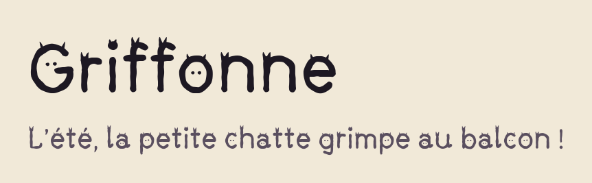
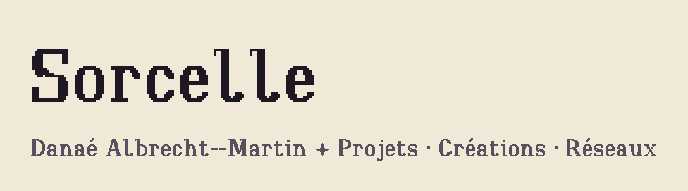

# Polices

Les polices d'écriture que je dessine : sources, versions, changelog et spécimens.

**Site : <https://polices.danaedev.fr/>** (essai en ligne, glyphes, CSS à copier, téléchargement, historique).

| Police | Style | Licence |
| --- | --- | --- |
| [Griffonne](fonts/griffonne/) | Pinceau irrégulier où chaque lettre cache un chat ; GF Latin Core, `calt` `ss01` `case` `zero` | OFL 1.1 |
| [Sorcelle](fonts/sorcelle/) | Pixel « lombarde arrondie », 3 graisses, GF Latin Core, pour les titres | OFL 1.1 |

<picture>
  <source media="(prefers-color-scheme: dark)" srcset="fonts/griffonne/images/apercu-sombre.png">
  
</picture>

<picture>
  <source media="(prefers-color-scheme: dark)" srcset="fonts/sorcelle/images/apercu-sombre.png">
  
</picture>

Chaque version publiée a son zip (TTF, WOFF2, OTF quand la police en a un, licence, changelog) dans les
[releases](https://github.com/dalbrechtmartin/fonts/releases).

## Utiliser une police sur un site

Chaque police a un `index.css` (toutes les graisses) et une feuille par graisse (`400.css`, `700.css`…).

- Sans rien installer, depuis GitHub Pages :

  ```css
  @import url("https://polices.danaedev.fr/fonts/sorcelle/index.css");
  ```

- Avec npm (paquets `@danaedev/<id>`) :

  ```bash
  npm i @danaedev/sorcelle
  ```

  ```js
  import "@danaedev/sorcelle";          // toutes les graisses
  import "@danaedev/sorcelle/700.css";  // seulement Bold
  ```

## Lancer en local

```bash
python -m venv .venv
source .venv/Scripts/activate            # PowerShell : .venv\Scripts\Activate.ps1
pip install -r requirements.txt
python tools/polices.py construire       # compile chaque police dans fonts/<id>/dist/
python tools/polices.py site             # génère _site/ : pages, polices.json, polices, CSS, zips, image de partage, sitemap
python tools/polices.py npm sorcelle     # prépare le paquet npm dans npm/sorcelle/
python -m http.server 8000 --directory _site
```

Puis ouvrir <http://localhost:8000/> : les liens du site partent du chemin de `URL_SITE` (`tools/polices.py`), ici la
racine du domaine. Le site est publié par GitHub Pages sur le domaine `polices.danaedev.fr` (réglage du dépôt, DNS chez
l'hébergeur du domaine) ; les anciennes adresses `dalbrechtmartin.github.io/fonts/…` y sont redirigées par GitHub.

## Vérifier

```bash
python tools/polices.py verifier         # toutes les polices, ou : verifier sorcelle
```

Contrôle les clés de `police.json`, la licence, le changelog, la famille et la graisse de chaque fichier, les glyphes du
spécimen, la révision écrite dans la police et l'accord avec `.release-please-manifest.json`. Code de sortie 1 en cas d'erreur.

### Hooks Git

Une fois par poste, depuis la racine (Node 20 ou plus) :

```bash
npm install                              # lefthook et commitlint, puis installe les hooks
pip install -r requirements-dev.txt      # ruff
winget install Gitleaks.Gitleaks         # macOS : brew install gitleaks
```

À chaque commit : `ruff check` sur les fichiers Python indexés et `gitleaks` (secrets) ; le message doit suivre
Conventional Commits (`commitlint`). Lint de tout le dépôt : `ruff check .`.

## Déploiement

Tout passe par GitHub Actions, sans variable ni secret :

- [`ci.yml`](.github/workflows/ci.yml) : `construire`, `verifier` et `site` à chaque push et PR vers `main` et `develop`.
- [`pages.yml`](.github/workflows/pages.yml) : publie le site sur GitHub Pages à chaque push sur `main`.
- [`release-please.yml`](.github/workflows/release-please.yml) : ouvre la PR de version, crée la release, y joint le zip et publie le paquet npm (trusted publishing, sans secret).

Réglages du dépôt en place :

- `main` protégée : PR obligatoire, ni push forcé ni suppression, règle appliquée aussi aux admins ;
- Pages en source « GitHub Actions » ;
- Actions avec les droits en écriture et l'autorisation de créer des PR (nécessaire à release-please).

## Maintenance

### Publier une nouvelle version

Chaque police a sa propre version (semver), son `CHANGELOG.md` et ses tags (`griffonne-v1.0.0`), gérés par
[release-please](https://github.com/googleapis/release-please) à partir des [Conventional Commits](https://www.conventionalcommits.org/fr/).

1. Travailler sur `develop`. C'est le dossier touché qui désigne la police ; le type fixe la version :
   - `feat(sorcelle): …` → mineure (0.6.0 → 0.7.0) ;
   - `fix(sorcelle): …` → correctif (0.6.0 → 0.6.1) ;
   - `feat(sorcelle)!: …` → majeure (mineure tant qu'on est en 0.x) ;
   - `refactor`, `docs`, `chore`, `ci` → pas de version.
2. Ouvrir une PR `develop` → `main` et la fusionner une fois la CI verte.
3. release-please ouvre une PR par police modifiée (version dans `police.json`, manifeste, `CHANGELOG.md`).
   Elle n'a pas de CI : GitHub ne lance pas les workflows sur une PR créée par GitHub Actions.
4. La fusionner : tag, release et zip, puis le site se met à jour.
5. Facultatif : décrire la version en français pour le site dans `police.json`, clé `notes`
   (`{"1.2.0": {"Nouveautés": ["…"], "Corrections": ["…"]}}`). Sans note, le site affiche les messages de commit ;
   `verifier` refuse une note pour une version absente du CHANGELOG.

La version écrite dans les fichiers de police vient toujours de `police.json` : `construire` l'écrit aussi dans les
polices fournies compilées (Griffonne), et `verifier` refuse un écart.

### Ajouter une police

```bash
python tools/polices.py nouvelle <id> "<Nom>"
```

Crée `fonts/<id>/` (police.json, CHANGELOG, README, OFL.txt) et la déclare à release-please en `0.0.0` : non publiée,
absente du site. La commande affiche ensuite les étapes : compléter `police.json` (dont `langues`, affichées sur le site
avec une phrase par langue tirée de `PHRASES_LANGUES`, et pour chaque fonction OpenType `libelle`, `description` et un
`exemple` court : le site y marque les signes qui changent, calculés avec HarfBuzz), ajouter les fichiers compilés
dans `compilees/` (ou une commande `construction`), vérifier, puis committer `feat(<id>): première version`.

### Publier une police sur npm pour la première fois

npm ne permet de déclarer la publication depuis GitHub Actions (trusted publishing) que pour un paquet qui existe déjà :

1. être membre de l'organisation npm `danaedev`, avec la 2FA activée, et connectée (`npm login`) ;
2. publier la première version à la main :

   ```bash
   python tools/polices.py npm <id>
   npm publish ./npm/<id> --access public
   ```

3. autoriser `release-please.yml` à publier le paquet (`npm trust github`, 2FA demandée ; `--essai` pour voir sans
   rien changer) :

   ```bash
   python tools/polices.py npm-confiance <id>
   ```

Les versions suivantes partent ensuite avec la release. La première doit arriver dans les 2 jours, sinon l'autorisation
expire : `npm trust list @danaedev/<id>`, `npm trust revoke @danaedev/<id> --id=<id-confiance>`, puis la recréer.

Les images du README d'une police se régénèrent avec `python tools/polices.py apercus <id>`.

### Dépendances

Dependabot propose chaque semaine, sur `develop`, les mises à jour pip et GitHub Actions.

## Structure

```
fonts/<id>/        une police : police.json, CHANGELOG.md, OFL.txt, README.md, sources et scripts
tools/polices.py   construire, vérifier, empaqueter, site, paquet npm, aperçus, nouvelle police
site/modeles/      pages du site (Jinja) : accueil, une page par police, ses versions, 404 ; rendues par la commande site
site/              CSS, interactions (site.js) et copie du design system Grimoire
```

## Licences

- **Polices** : [SIL Open Font License 1.1](https://openfontlicense.org), voir le `OFL.txt` de chaque police.
- **Code** (outils, site) : [BSD 3-Clause](LICENSE).
- **Grimoire** (`site/grimoire/`, `site/icones.svg`) : design system de mon portfolio ; polices Alegreya et Atkinson
  Hyperlegible (OFL) chargées depuis Google Fonts, icônes [Phosphor](https://phosphoricons.com/) (MIT).
