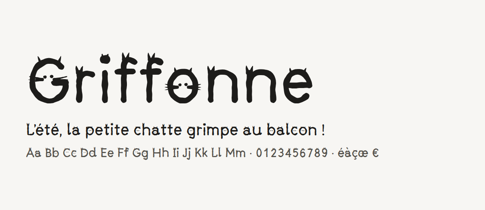

<picture>
  <source media="(prefers-color-scheme: dark)" srcset="documentation/images/griffonne-sombre.png">
  
</picture>

# Griffonne

Une police au pinceau où chaque lettre cache un chat : des oreilles sur les hampes, des yeux dans les panses, des queues aux terminaisons. Lisible dès 16 px, féline dès le premier regard.

- **Version** : voir le [CHANGELOG](CHANGELOG.md) · **Licence** [SIL Open Font License 1.1](OFL.txt) · **Autrice** Danaé ALBRECHT--MARTIN
- **8 langues** (couverture GF Latin Core, 319 caractères) : français, anglais, allemand, espagnol, polonais, tchèque, roumain, turc
- **Spécimen** : [en ligne](https://dalbrechtmartin.github.io/fonts/#griffonne), ou `specimen/index.html` (thèmes clair et sombre, fonctions à essayer)

## Ce qu’elle sait faire

| Fonction | Effet | CSS |
|---|---|---|
| `calt` (actif par défaut) | 3 tracés de pinceau qui alternent : deux lettres voisines ne sont jamais identiques | `font-feature-settings: "calt" 0` pour le couper |
| `ss01` « Chats complets » | moustaches sur toutes les lettres à visage, pour les titres dès 32 px | `font-feature-settings: "ss01" 1` |
| `case` | parenthèses, crochets, tirets et guillemets centrés sur les capitales | `font-feature-settings: "case" 1` |
| `zero` | zéro barré | `font-variant-numeric: slashed-zero` |

Chiffres tabulaires par défaut (les colonnes de nombres s’alignent), capitales centrées verticalement dans les boutons, typographie française complète.

## Installer

Télécharger l’archive `griffonne-<version>.zip` depuis les [versions du dépôt](https://github.com/dalbrechtmartin/fonts/releases?q=griffonne), puis :

- **Ordinateur** : `otf/Griffonne-Regular.otf`, double-clic puis *Installer*.
- **Windows, petites tailles à l’écran** : préférer `ttf/Griffonne-Regular.ttf` (hinté).
- **Web** :

```css
@font-face {
  font-family: "Griffonne";
  src: url("Griffonne-Regular.woff2") format("woff2");
  font-display: swap;
}
h1 { font-family: "Griffonne", system-ui, sans-serif; font-feature-settings: "ss01" 1; }
```

Pour le texte courant, garder un interlignage d’au moins 1,5 et une taille d’au moins 16 px.

## Licence et mention

Griffonne est libre : utilisation, modification et redistribution autorisées, y compris commercialement, sous [SIL Open Font License 1.1](OFL.txt). Une version modifiée reste sous OFL et garde le copyright d’origine.

La mention n’est pas obligatoire, mais elle fait toujours plaisir :

> Police Griffonne par Danaé ALBRECHT--MARTIN (contact@danaedev.fr), licence SIL OFL 1.1

## Construire depuis les sources

Les lettres sont dessinées en code (`sources/generateur/`) : un squelette par lettre, un moteur de pinceau (épaisseur, pression, ondulation à graine fixe), puis espacement, crénage et fonctions OpenType mesurés.

Dans le dépôt [fonts](https://github.com/dalbrechtmartin/fonts), les polices compilées de `fonts/` sont versionnées telles quelles :
la CI du dépôt les vérifie, les publie sur le site et les joint aux releases, sans relancer cette chaîne (elle demande
fontmake, ttfautohint et Font Bakery). La version n'est jamais à écrire à la main : `python tools/polices.py construire`
copie ces fichiers et y écrit celle de `police.json`, tenue par release-please. Relancer la chaîne seulement quand le dessin
change, puis committer les nouveaux fichiers de `fonts/`.

```bash
python -m venv .venv && source .venv/Scripts/activate   # PowerShell : .venv\Scripts\Activate.ps1 ; macOS, Linux : .venv/bin/activate
pip install -r requirements.txt
# Dans cet ordre (le crénage dépend de l’espacement, les composés des deux) :
python sources/generateur/generer.py sources/Griffonne-Regular.ufo
python scripts/espacer.py sources/Griffonne-Regular.ufo
python scripts/composer_accents.py sources/Griffonne-Regular.ufo --jeu GF_Latin_Core --variantes alt1 alt2 ss01
python scripts/crener.py sources/Griffonne-Regular.ufo
python scripts/fonctions_opentype.py sources/Griffonne-Regular.ufo --nom-jeu ss01 "Chats complets"
python scripts/construire.py sources/
python scripts/verifier.py fonts/ttf/*.ttf --fontbakery
python scripts/preparer_publication.py
```

## Documentation

Brief, audit des références, spécification chiffrée et contrôle qualité : `documentation/`.
Historique des versions : [CHANGELOG.md](CHANGELOG.md) (tenu par release-please) et [FONTLOG.txt](FONTLOG.txt) (demandé par l’OFL).
