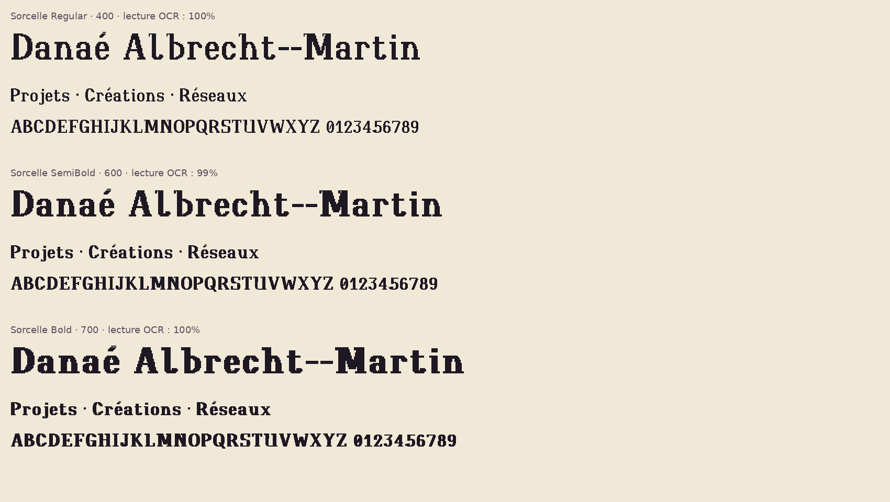

# Sorcelle

Police de titres de mon portfolio, en pixels, style « lombarde arrondie ». Trois graisses : Regular (400), SemiBold (600), Bold (700).



Dérivée de **Jacquard 24** (Soft Type, licence SIL OFL 1.1, sans nom réservé).
Sorcelle reste sous OFL 1.1 : gratuite, modifiable, jamais vendue seule, crédits d'origine conservés.

- Version actuelle : voir [`font.json`](font.json) ; historique : [`CHANGELOG.md`](CHANGELOG.md).
- Télécharger : [versions publiées](https://github.com/dalbrechtmartin/fonts/releases?q=sorcelle) (zip avec TTF, WOFF2 et licence).

## Contenu du dossier

| Fichier | Rôle |
| --- | --- |
| `font.json` | Nom, version, graisses, commande de build et textes du spécimen (lu par le site et par `tools/fonts.py`) |
| `CHANGELOG.md` | Historique des versions (tenu par release-please) |
| `OFL.txt` | Licence de Sorcelle |
| `sources/Jacquard24-Regular.ttf` + `sources/OFL.txt` | Police d'origine et sa licence |
| `planche.png` | Les 131 caractères (base de travail, retouchable dans Aseprite) |
| `glyphs_extra.json` | Glyphes ajoutés hors planche (λ) |
| `grid.py` | Géométrie de la planche (taille des cases, liste des caractères) |
| `extract.py` | Police → planche |
| `build.py` | Planche → `dist/` : Regular, SemiBold et Bold, en `.ttf` et `.woff2` |
| `weights.py` | Spécimen des trois graisses (`images/graisses.png`) et lecture OCR de chacune |
| `design_caps.py` | Dessine sur la planche les 26 capitales lisibles, leurs accentuées, Œ, Æ, le x minuscule et ✦ |
| `design_lower.py` | Dessine les minuscules, leurs accentuées, œ, æ, les chiffres et la ponctuation (à lancer après `design_caps.py`) |
| `variants.py` | Génère plusieurs styles de capitales et `variantes/comparaison.png` pour choisir |
| `variants_minuscules.py` | Compare les deux styles de minuscules |
| `specimen.py` | Aperçu Sorcelle / Jacquard 24 côte à côte (`images/specimen.png`) |
| `legibility.py` | Test de lisibilité : OCR Tesseract + capitales les plus proches |
| `images/` | Spécimens et comparaisons |
| `dist/` | Polices compilées (non versionnées : générées par `build.py`) |

## Installer (une fois)

Depuis la racine du dépôt :

```bash
python -m venv .venv
# PowerShell : .venv\Scripts\Activate.ps1   |   Git Bash : source .venv/Scripts/activate
pip install -r requirements.txt
```

## Retoucher les lettres

1. Ouvre `planche.png` dans Aseprite.
2. Dessine **en noir pur `#000000`** : seuls ces pixels deviennent des lettres.
   Les lignes de couleur et les étiquettes grises sont des repères, ignorés à la compilation.
   - ligne rose : ligne de base · ligne verte : hauteur des minuscules · ligne bleue : hauteur des capitales
   - trait gris vertical : largeur d'origine de la lettre
3. Reste dans ta case : la lettre commence à 4 px du bord gauche de la case.
4. Enregistre en PNG (même nom).

## Compiler et vérifier

Depuis la racine du dépôt :

```bash
python tools/fonts.py build sorcelle      # les 3 graisses dans fonts/sorcelle/dist/
python tools/fonts.py check sorcelle
```

Ou depuis ce dossier, avec les images de contrôle :

```bash
python build.py sources/Jacquard24-Regular.ttf planche.png dist   # les 3 graisses
python weights.py dist images/graisses.png
python specimen.py sources/Jacquard24-Regular.ttf dist/Sorcelle-Regular.ttf images/specimen.png
```

Ouvre `images/specimen.png` pour voir le résultat. La largeur de chaque lettre suit ton dessin.

La version écrite dans les polices vient de `font.json` : ne la change pas à la main, release-please s'en charge
(voir le [README du dépôt](../../README.md#versions-et-changelog)).

## Ce qui change par rapport à Jacquard 24

Toute la police est redessinée dans le même style « lombarde arrondie », sauf le § (celui de Jacquard est gardé).

- **Capitales** : squelette romain, fûts de 5 px, déliés de 2 px, panses rondes, têtes en crosse,
  empattements plats, sans filet. Accentuées recentrées, Œ et Æ recomposés.
- **Minuscules** : fûts de 4 px, panses rondes, crosse en haut des hampes, petit drapeau en haut des fûts courts.
  a à deux étages (≠ o), l avec sortie à droite (≠ I et 1), g à crochet ouvert. Accentuées, œ et æ suivent.
- **Chiffres** alignés (23 px, un peu sous les capitales) : 0 plus étroit et barré (≠ O), 1 avec long drapeau et socle.
- **Ponctuation** redessinée au même poids : points carrés, guillemets « », tirets, parenthèses, @, &, #, %…
- **Nouveaux glyphes** ✦ (U+2726) et λ (U+03BB).
- Hauteurs de Jacquard conservées : x = 17 px, capitales et hampes = 25 px, jambages = 7 px.
- Un seul contour par forme et un petit pont sur les jointures diagonales : pas de stries ni de trous à l'anticrénelage
  (`images/stries-avant-apres.png`).

## Graisses

Une seule planche dessine les lettres ; `build.py` en tire trois graisses en épaississant chaque pixel vers la droite :
Regular (+0 px), SemiBold (+1 px), Bold (+2 px). La chasse s'élargit d'autant, donc les espaces entre lettres et
l'intérieur des lettres restent lisibles.

| Graisse | Fichier | CSS | Lecture OCR (7 phrases) |
| --- | --- | --- | --- |
| Regular | `Sorcelle-Regular.woff2` | `font-weight: 400` | 99,6 % |
| SemiBold | `Sorcelle-SemiBold.woff2` | `font-weight: 600` | 98,7 % |
| Bold | `Sorcelle-Bold.woff2` | `font-weight: 700` | 99,5 % |

Les glyphes hors de la planche (rares symboles hérités de Jacquard 24) restent en Regular dans les trois fichiers.

## Lisibilité mesurée (24/10/2026)

| Mesure | Jacquard 24 | Sorcelle 0.3 |
| --- | --- | --- |
| OCR Tesseract, 7 phrases (capitales, minuscules, chiffres) | 82 % | 99,6 % |
| Paire de capitales la plus proche | C / E : 5 % de différence | C / G : 27 % |
| o / 0 | 12 % | 49 % |
| a / o | 14 % | 52 % |
| n / u | 10 % | 33 % |
| I / 1 | 86 % | 53 % |

Pourcentage = part de pixels différents entre deux lettres : plus il est haut, moins on les confond.
La seule erreur OCR restante : un « l » minuscule lu « L ».

Lisibilité selon la taille d'affichage (OCR, 7 phrases) :

| Taille CSS | 24 px | 32 px | 43 px | 64 px | 86 px |
| --- | --- | --- | --- | --- | --- |
| Lecture OCR | 97 % | 99 % | 100 % | 100 % | 100 % |
| Pixel de la police à l'écran | 0,56 px | 0,74 px | 1 px | 1,49 px | 2 px |

Test de lecture « Lire Sorcelle » (25/10/2026, 5 personnes) : 59 mots sur 60 lus justes, facilité moyenne 4,8 / 5.

Règles d'usage :
- titres uniquement, **à partir de 32 px** ; jamais pour un paragraphe ;
- pour des pixels nets, utiliser **43 px** (h2, h3) ou **86 px** (h1) : un pixel de la police = 1 ou 2 pixels d'écran ;
  entre les deux, les bords sont lissés (lisible, mais moins net) ;
- prévoir une option « Police lisible » qui remplace Sorcelle (sur mon portfolio : Atkinson Hyperlegible Next).

## Tout régénérer

```bash
python extract.py sources/Jacquard24-Regular.ttf planche.png
python design_caps.py sources/Jacquard24-Regular.ttf planche.png
python design_lower.py sources/Jacquard24-Regular.ttf planche.png
python build.py sources/Jacquard24-Regular.ttf planche.png dist   # les 3 graisses
python weights.py dist images/graisses.png
python specimen.py sources/Jacquard24-Regular.ttf dist/Sorcelle-Regular.ttf images/specimen.png
python legibility.py sources/Jacquard24-Regular.ttf dist/Sorcelle-Regular.ttf   # nécessite Tesseract
```

## Comparer des styles de capitales

```bash
python variants.py sources/Jacquard24-Regular.ttf variantes
```

Les styles sont définis en haut de `variants.py`. Styles retenus : `STYLE` en haut de `design_caps.py` (capitales)
et `LSTYLE` en haut de `design_lower.py` (minuscules : `ronde` ou `brisee`).

## Repartir de zéro

`python extract.py sources/Jacquard24-Regular.ttf planche.png` régénère la planche d'origine
(attention : écrase tes retouches, garde une copie).
