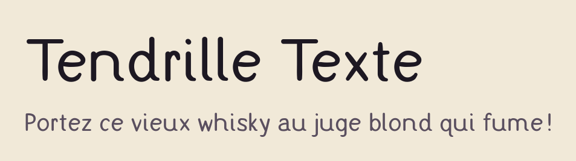

# Tendrille Texte

<picture>
  <source media="(prefers-color-scheme: dark)" srcset="images/apercu-sombre.png">
  
</picture>

La version sobre de [Tendrille](../tendrille/) : la même écriture, avec un contraste faible, des points ronds et sans
ruban, pour les **petites tailles**, les **interfaces** et les **personnes malvoyantes**.

- Lisible dès 12 px ; b d p q jamais en miroir, I l 1 et 0 O différenciés, grande hauteur d'x.
- Fonctions : `case`, `tnum`, `zero`, `ss01` (a d'école), `ss02` (points en cœur).
- Langues : GF_Latin_Core (français et langues européennes à alphabet latin).

Ses sources, sa documentation et sa construction sont celles de Tendrille : voir [fonts/tendrille](../tendrille/).

## Licence

[SIL Open Font License 1.1](OFL.txt). Si Tendrille Texte vous sert, une mention fait toujours plaisir (facultatif) :

> Police Tendrille Texte par Danaé ALBRECHT--MARTIN — https://danaedev.fr
