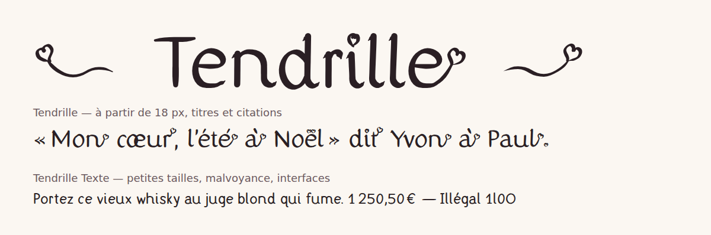

# Tendrille

<picture>
  <source media="(prefers-color-scheme: dark)" srcset="documentation/images/apercu-sombre.png">
  
</picture>

Tendrille est une **semi-manuscrite de lecture**, romantique et élégante, dessinée à la plume. Ses points sont des cœurs, et la dernière lettre de chaque mot s'envole en un ruban qui s'enroule en cœur.

Elle est pensée pour être lue par le plus grand nombre : lettres jamais en miroir, formes faciles à distinguer, grande hauteur d'x, espacement aéré.

## Deux familles

| Famille | Pour | Caractère |
|---|---|---|
| **Tendrille** | texte à partir de 18 px, titres, citations, invitations | plume contrastée, points en cœur, rubans à cœur en fin de mot |
| **Tendrille Texte** | petites tailles, malvoyance, interfaces | la même écriture, sobre : contraste faible, points ronds, sans ruban |

## Installer

- **Ordinateur** : dans `fonts/otf/`, double-cliquer sur la police, puis « Installer ».
- **Web** : utiliser les fichiers `fonts/webfonts/*.woff2`.

```css
@font-face {
  font-family: "Tendrille";
  src: url("Tendrille-Regular.woff2") format("woff2");
  font-display: swap;
}
@font-face {
  font-family: "Tendrille Texte";
  src: url("TendrilleTexte-Regular.woff2") format("woff2");
  font-display: swap;
}

h1, blockquote { font-family: "Tendrille", cursive; }
body { font-family: "Tendrille Texte", system-ui, sans-serif; line-height: 1.5; }
```

## Fonctions OpenType

| Fonction | Nom dans les logiciels | Effet |
|---|---|---|
| `calt` (active par défaut) | Variantes contextuelles | ruban à cœur sur la dernière lettre des mots (Tendrille) |
| `case` | Formes pour capitales | tirets, parenthèses et guillemets centrés sur les capitales : (PARIS) |
| `tnum` | Chiffres tabulaires | chiffres de même largeur, pour les tableaux et les prix |
| `zero` | Zéro barré | 0 barré |
| `ss01` | a d'école | a à un étage, comme à l'école |
| `ss02` | Points ronds / Points en cœur | inverse la forme de tous les points |
| `ss04` | Capitales à cœur | un cœur suspendu aux capitales (Tendrille), pour les titres |
| `ss05` | Sans rubans de fin de mot | une Tendrille plus calme |

Exemples en CSS :

```css
.titre   { font-feature-settings: "ss04"; }                 /* capitales à cœur */
.tableau { font-variant-numeric: tabular-nums; }            /* chiffres tabulaires */
.lecture { font-feature-settings: "ss01", "ss02", "ss05"; } /* a d'école, points ronds, sans ruban */
```

Ornements à taper ou coller : **❦** avant un titre, **❧** après, **♡**.

## Accessibilité

- **b d p q** ne sont jamais le reflet l'une de l'autre ; **I l 1**, **O 0 o** et **rn m** sont différenciés (mesures dans `documentation/controle.md`).
- Grande hauteur d'x, ouvertures larges, espaces généreuses entre les lettres et entre les mots.
- **a d'école** (`ss01`) pour les enfants qui apprennent à lire.
- **Tendrille Texte** pour les petites tailles et les personnes malvoyantes.

Aucune police ne « soigne » la dyslexie : ces choix rendent les lettres plus faciles à distinguer, c'est tout ce qu'ils promettent.

## Langues

Jeu **GF_Latin_Core** : français (avec espace fine insécable) et les langues européennes à alphabet latin. Extensions prévues : GF_Latin_Plus, puis GF_Latin_African.

## Construire depuis les sources

```bash
python -m venv .venv
source .venv/bin/activate          # PowerShell : .venv\Scripts\Activate.ps1
pip install -r requirements.txt
./generer.sh                        # dessin, espacement, accents, fonctions, crénage, build, spécimen
```

Les lettres sont dessinées par un programme : `sources/generateur/generateur.py`. Tous les réglages (hauteurs, plume, rubans, cœurs, espacement) sont dans son dictionnaire `PARAMETRES`. Le build est reproductible : un clone propre reconstruit des polices identiques.

## Licence

Tendrille est sous licence [SIL Open Font License 1.1](OFL.txt) : libre d'utiliser, d'étudier, de modifier et de redistribuer, y compris commercialement. Le copyright et la licence accompagnent toujours la police et ses versions modifiées.

Si Tendrille vous sert, une mention fait toujours plaisir (facultatif) :

> Police Tendrille par Danaé ALBRECHT--MARTIN — https://danaedev.fr
