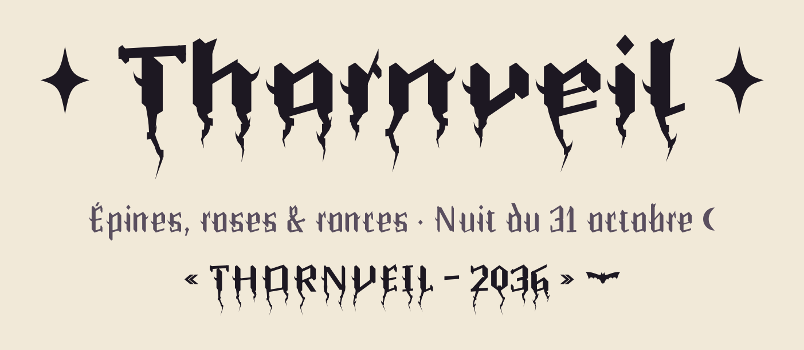

# Thornveil

<picture>
  <source media="(prefers-color-scheme: dark)" srcset="documentation/images/apercu-sombre.png">
  
</picture>

Thornveil est une **gothique moderne, épineuse et sombre**, pensée pour composer des logos. Ses fûts sont taillés en losange, chaque lettre porte une épine de rose, et les queues de g, j, y et J finissent en pique de diable. Ses jeux stylistiques font **fondre les lettres en ronces** sous la ligne de base.

Lisible malgré le genre : ni black metal illisible, ni manuscrit médiéval.

## Installer

- **Ordinateur** : dans `fonts/otf/`, double-cliquer sur une graisse, puis « Installer ». Ou `fonts/variable/Thornveil-VF.ttf` : un seul fichier pour toutes les graisses de 300 à 900.
- **Web** : utiliser `fonts/webfonts/Thornveil-VF.woff2`.

```css
@font-face {
  font-family: "Thornveil";
  src: url("Thornveil-VF.woff2") format("woff2");
  font-weight: 300 900;
  font-display: swap;
}

.logo { font-family: "Thornveil", serif; font-weight: 800; }
```

## Fonctions OpenType

| Fonction | Nom dans les logiciels | Effet |
|---|---|---|
| `ss01` | Capitales et chiffres coulants | capitales et chiffres fondent en ronces sous la ligne de base |
| `ss04` | Minuscules coulantes | les minuscules fondent à leur tour |
| `ss02` | Épines renforcées | épine longue et seconde épine sur chaque minuscule |
| `case` | Formes pour capitales | tirets, guillemets et points médians centrés sur les capitales : « NUIT – ROSES » |
| `zero` | Zéro pointé | losange au centre du 0, distinct du O |

Les trois jeux se cumulent. Exemples en CSS :

```css
.logo-coulant { font-feature-settings: "ss01", "ss04"; line-height: 1.6; } /* tout fond en ronces */
.logo-epineux { font-feature-settings: "ss02"; }                          /* épines renforcées */
.titre-capitales { text-transform: uppercase; font-feature-settings: "case"; }
```

Les ronces descendent sous la boîte de ligne : sur plusieurs lignes, prévoir un interlignage d'au moins **1,6**.

Ornements à taper ou coller : **✦ ✧ ☽ ☾ ♥**, et une chauve-souris sur 🦇 (U+1F987) ou, si le système affiche son emoji en couleur, sur U+E000 (zone privée). Dans un logo web, ces ornements sont décoratifs : `aria-hidden="true"`, le nom porté par le texte alternatif.

## Accessibilité

- **b d p q** ne sont jamais le reflet l'une de l'autre ; **n u**, **I l 1**, **O 0 o** et **rn m** sont différenciés (mesures dans `documentation/controle.md`).
- Capitales par défaut proches du romain, ornements réservés aux jeux stylistiques.
- Police de **titrage** : lisible dès 12 px, mais les épines s'effacent sous 16 px environ. Pour du texte courant, choisir une autre police.

## Langues

Jeu **GF_Latin_Core** : français (avec espace fine insécable) et les langues européennes à alphabet latin. Le letton prend la virgule souscrite (ķ ļ ņ ģ), le tchèque et le slovaque le caron en apostrophe (ď ť ľ). Extension prévue : GF_Latin_Plus.

## Construire depuis les sources

```bash
python -m venv .venv
source .venv/bin/activate          # PowerShell : .venv\Scripts\Activate.ps1
pip install -r requirements.txt
./generer.sh                        # dessin, espacement, accents, crénage, fonctions, build, spécimen
```

Les lettres sont dessinées par un programme : `sources/generateur/`. Les décisions chiffrées sont dans `parametres.py`, une valeur à un seul endroit. Le build est reproductible : un clone propre reconstruit des polices identiques.

## Licence

Thornveil est sous licence [SIL Open Font License 1.1](OFL.txt), sans nom réservé : libre d'utiliser, d'étudier, de modifier et de redistribuer, y compris commercialement. Le copyright et la licence accompagnent toujours la police et ses versions modifiées.

Si Thornveil vous sert, une mention fait toujours plaisir (facultatif) :

> Police Thornveil par Danaé ALBRECHT--MARTIN — https://danaedev.fr
